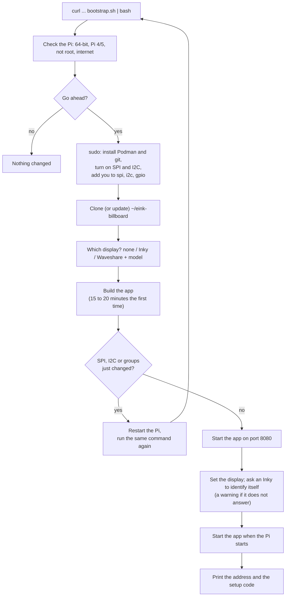

# eInk Billboard

This is a project to use the [InkyPi](https://github.com/fatihak/InkyPi) project to:

* Learn Python
* Play with Raspberry Pi
* Play with e-Ink technology

We have a reMarkable tablet, and enjoy it very much.  Also a long-standing fascination with e-Ink technology.

# Set up a Raspberry Pi

From a fresh Raspberry Pi to a working billboard in one command. The app runs in a container (Podman), so the Pi itself only gets Podman, git and its panel connections switched on; Python, the browser that draws the pages and the panel drivers are all inside the container.

> **Status:** the whole setup has been run start to finish on a Raspberry Pi 5 (Raspberry Pi OS Bookworm, Podman 4.3), including starting again after a restart, with no panel attached: the app opens the panel's devices and loads every driver inside the container, but no panel has been driven yet.

## What you need

* A **Raspberry Pi 4 or 5** with **Raspberry Pi OS 64-bit** (Bookworm or later), on your network, with internet access.
  * **Memory:** 1 GB or more is comfortable (the app uses about 135 MB and each page drawn with the browser about 75 to 110 MB). A Pi 3, a Pi 3 A+ or a **Pi Zero 2 W** (the smallest 64-bit board) should work too, but only the Pi 5 has been tried: with 512 MB it needs swap (`deploy/eink-container.sh check` says), draws one page at a time, and building the image on it is the part most likely to run out of memory. Boards with a 32-bit system only (Pi 1, Pi Zero and Zero W, Pi 2 before the v1.2) cannot run it.
* Your own user on it, allowed to use `sudo` (the user Raspberry Pi Imager makes is).
* A panel, or none yet: a **Pimoroni Inky** (it identifies itself) or a **Waveshare e-Paper** (you choose its model, e.g. `epd7in3e`; the name is on the panel's Waveshare wiki page). With no panel you can still try the whole app; the pages are drawn but not shown.
* About 4 GB of free space and 20 minutes for the first build.

## 1. Run the setup

Sign in to the Pi (over SSH, or a terminal on its desktop) as your own user, **not** with `sudo`, and run:

```
curl -fsSL https://raw.githubusercontent.com/escape-llc/eink-billboard/master/deploy/bootstrap.sh | bash
```

It checks the Pi, **lists what it will do and asks once**, then asks for your password where it needs `sudo`. Add `--dry-run` at the end (`... | bash -s -- --dry-run`) to see the list without changing anything.



## 2. Restart, if it asks

Switching on SPI and I2C and joining the `spi`, `i2c` and `gpio` groups take effect only after a restart. When any of them changed, the setup builds the app first, then asks to restart. After the restart, run **the same command again**: it skips what is done and finishes in a minute or two.

## 3. Claim the device

The setup ends with something like:

```
The device is not set up yet. Open the web app and enter the setup code to choose its password:
    Open the web app:  http://192.168.1.20:8080
    Setup code:        2941 1673
```

Open that address from any computer or phone on your network, enter the setup code, and choose the device's password. The code is also on the panel, and `~/eink-billboard/deploy/eink-container.sh code` shows it again. Until the device is claimed **nothing else plays**: the panel holds the setup page, so whoever can see the panel is its owner.

## 4. Make your first playlist

After you sign in, the web app opens the playlist page, since a new device has none: create a playlist, add tracks (a slide show of pictures, a calendar, the weather, comics, ...) and save it. Timer tasks (the clock on the quarter hour, a weather overlay in a corner) are in the Scheduler. The display type can be changed later under Settings, Display.

## Update

```
~/eink-billboard/deploy/eink-container.sh update
```

It fetches the latest code into `~/eink-billboard`, builds it and restarts the app, keeping your settings, playlists and password; when there is nothing new it says so and leaves the app running. (Running the setup command again does the same, and also re-checks the Pi.)

## On your network

The setup starts the app with these settings from the environment, so set them in front of `start` (or the setup command) to change them, e.g. `EINK_ALLOW_HOSTS=billboard.home.arpa ~/eink-billboard/deploy/eink-container.sh start`:

| Setting | What it does |
|---|---|
| `EINK_PUBLIC_URL` | The address people open, shown with the setup code and on the panel's pages. The default is `http://<the Pi's address>:8080`; set it when you reach the Pi by a name of your own (`http://billboard.home.arpa:8080`) |
| `EINK_ALLOW_HOSTS` | Names the app answers to, besides IP addresses and the Pi's own name (`<name>` and `<name>.local`), comma separated. Any other name is refused (421): that stops a web page on another site from reaching the device by DNS rebinding. A name in `EINK_PUBLIC_URL` counts too |
| `EINK_API_TOKEN` | A token for scripts (`Authorization: Bearer ...`); it also counts as setting the device up. Passed to the container by name, never on a command line |

A client that gets the password or token wrong repeatedly has to wait (429), and each failure is in the log.

**HTTPS.** The app speaks plain HTTP, which is normal on a home network (the password reaches the Pi in the clear). For HTTPS put a reverse proxy in front of port 8080, for example Caddy, and add its name to `EINK_ALLOW_HOSTS`:

```
billboard.home.arpa {
	reverse_proxy localhost:8080
}
```

Behind a proxy the app sees plain `http`, so its session cookie is not marked `Secure` (forwarded headers are deliberately not trusted).

## When something does not work

Run `~/eink-billboard/deploy/eink-container.sh check` first. It looks at the Pi, its devices, the container and the display, and gives a fix for each problem it finds (the lines marked `FIX`). The rest of the commands are in [The command line](#the-command-line) below.

## The command line

Everything after the setup is one script in the clone, [`deploy/eink-container.sh`](deploy/eink-container.sh). Run it as yourself, not with `sudo`, from any folder:

```
~/eink-billboard/deploy/eink-container.sh COMMAND [ARGUMENTS]
```

Every command first checks the basics (Linux, not root, Podman and curl installed, run from the clone, a valid port and address) and stops with what to do when one is wrong. Nothing it prints contains the app's settings, which can hold API keys and passwords.

### Commands

| Command | What it does |
|---|---|
| `help` | Lists the commands and settings. |
| `update` | **Brings it up to date:** fetches the latest code into the clone, builds it and starts it (your data is kept). When nothing is new and the app already runs it, it says so and does nothing. Refuses when the clone has changes of your own. `update TAG` switches to a release by its tag, once there are releases; a plain `update` on a release stays on it. |
| `build` | Builds the app's image (`localhost/eink-device`) from the clone as it is, without fetching anything (`update` fetches): 15 to 20 minutes the first time, a few minutes after an update. Checks for about 4 GB of free space first, records the commit it was built from, and writes everything to `~/.cache/eink-billboard/build.log`; on failure it shows the end of that log. |
| `start` | Starts the app (or replaces the running one; the data is kept) on port 8080 of every address of the Pi. Passes in the panel's devices that exist (`/dev/spidev0.0`, `/dev/spidev0.1`, `/dev/i2c-1`, `/dev/gpiochip0`) with your `spi`, `i2c` and `gpio` groups, warns when a group is missing, refuses a port that is already in use, waits up to 90 seconds for the app to answer (showing its last log lines if it stops), then prints the setup code. Also `restart`. |
| `stop` | Stops and removes the container. The settings, playlists and password are kept, in the volume `eink-data`. |
| `logs` | The app's log; `logs -f` follows it (Ctrl+C to stop). |
| `code` | The address and the setup code while the device is not set up, otherwise that it is set up (or needs no code because of a token). |
| `check` | The troubleshooting report: the Pi (64-bit, Podman version, groups, SPI, I2C), the devices, the image and the commit it came from (compared with the clone), whether the app answers, which devices it can open and which driver libraries load inside the container, the chosen display, the setup state, start-at-boot, whether an Inky answers, and what the display said when the app last started. Ends with how many things are fine and how many to fix. |
| `display mock` | No panel: the pages are drawn but not shown. Saves the choice through the app's own settings and restarts the app, then shows whether the display started. |
| `display inky` | A Pimoroni Inky (it says which one it is). |
| `display waveshare MODEL` | A Waveshare panel; the model is checked against the drivers (`models`). |
| `models` | The Waveshare models there are drivers for, e.g. `epd7in3e` for the 7.3 inch e-Paper HAT (E). |
| `detect` | Asks the I2C bus whether an Inky is attached (a read only). Exit status 0: an Inky answered; 3: none did; 4: it could not ask (the app is not running, or I2C is off). |
| `autostart on` | Starts the app when the Pi starts: a systemd unit of your own (`~/.config/systemd/user/eink-billboard.service`) that starts the container, and *linger*, which runs your units at boot without a login (asks for your password once). Needs the container to exist (`start` first). |
| `autostart off` | No longer starts at boot (the app keeps running now). |
| `autostart` | Whether it starts at boot (`status`). |
| `reset-password` | Forgets the device password, restarts and shows the new setup code. Asks you to type `yes` first. |
| `wipe` | Deletes everything the app keeps (settings with their API keys, playlists, schedules, password) and the container, so the next `start` is a new device. Asks you to type the volume's name (`eink-data`) first. |

`reset-password` and `wipe` refuse to run without someone at the keyboard to answer.

### Settings

Optional, from the environment, for one command (`EINK_PORT=8090 ~/eink-billboard/deploy/eink-container.sh start`):

| Setting | Default | What it is |
|---|---|---|
| `EINK_PORT` | `8080` | The port on the Pi. Below 1024 needs a system setting, which `start` explains |
| `EINK_PUBLIC_URL` | `http://<the Pi's address>:<port>` | The address people open the web app at (see [On your network](#on-your-network)) |
| `EINK_ALLOW_HOSTS` | `<name>,<name>.local` | Names the app answers to besides addresses |
| `EINK_API_TOKEN` | none | A token for scripts |
| `EINK_NAME` | `eink` | The container's name |
| `EINK_IMAGE` | `localhost/eink-device` | The image's name |
| `EINK_VOLUME` | `eink-data` | The volume that holds the app's data |

### The setup command's options

The setup (`deploy/bootstrap.sh`) can be run again at any time; these change how it runs (after `| bash -s --`, e.g. `curl ... | bash -s -- --dry-run`):

| Option or setting | What it does |
|---|---|
| `--dry-run` | Shows what it would do, changes nothing |
| `--yes` | Asks nothing: goes ahead, and the display is `EINK_DISPLAY` (or the last choice, or none) |
| `--help` | Its description |
| `EINK_DISPLAY` | The display without asking: `mock`, `inky`, or `waveshare:MODEL` (e.g. `waveshare:epd7in3e`) |
| `EINK_REF` | The branch or tag to install (`master`) |
| `EINK_DIR` | Where the app is cloned (`~/eink-billboard`) |
| `EINK_REPO` | The repository to clone |

It remembers the display you chose in `~/.config/eink-billboard/display` and offers it next time.

## Remove it

```
~/eink-billboard/deploy/eink-container.sh autostart off
~/eink-billboard/deploy/eink-container.sh wipe          # deletes the app's data (asks first)
podman rmi localhost/eink-device
rm -rf ~/eink-billboard ~/.config/eink-billboard ~/.cache/eink-billboard
```

Podman, SPI, I2C and your groups stay as they are.

# Goals

> Disclaimer: this is not a judgment on the original source code!

After reviewing the code of the [InkyPi](https://github.com/fatihak/InkyPi) project, we got a plan:

* Support Windows-based development
	* Exercise Python's multi-platform capabilities
* Task-based architecture with Message Passing
	* Explore the multi-thread capabilities of Python
	* Explore Python's `async`/`await`
	* We actually build Real Production Apps this way!
* Unit test coverage of the Python code
* Playlist scheduling model
	* Provides images for the main background display (see below)
	* No concept of time-of-day
* "Day-planner" scheduling model
	* Time/date sensitive tasks
	* Tasks have day/time "trigger"
	* Tasks run plugins
		* Different settings per task
	* Multiple tasks may trigger at the same time
* Replace Jinja with a modern web front end toolchain
	* Vite
	* Vue JS
	* Descriptor-based UI
* Different architecture for settings, etc.
	* Described in JSON configuration
	* Web settings UI automatically build themselves
* Color theme
	* Device-wide algorithmic color scheme
	* Unified colors for all components
* Re-implement existing plugins as `async` data sources
	* The existing plugins just render one/list of image(s)
	* Encapsulate the notion of "list of images"
	* Data sources may use other data sources
* Plugins now "render" data sources to display layers (see below)
	* Handles any data source with matching "features"
	* Fewer and simpler plugins
* Re-implement plugins as `async`
	* Plugins are general-purpose "media player" like a slide-show
	* Same plugin handles many data sources
	* Tied to the display policy (see below) instead of the data
* Re-implement with `async` tasks
	* Self-hosting `async` loops for isolation between different tasks
	* Easy cancellation during shutdown or re-configuration
	* Greatly simplifies implementations
* Support same displays
	* Pimoroni
	* Waveshare
	* Mock
	* Tk
* Components do not require web authoring (for configuration) unless they need custom UI
	* This is separate from plugins rendering content via `chromium-headless-shell`
	* Schema descriptors provide the web application with metadata to build UI automatically
* Plugins and Data Sources have more infrastructure support
	* Set timers (for slideshows, etc.)
	* Schedule async operations, e.g. HTTP
	* Plugin (temporary) state (saved as JSON)

> Some of the Goals may seem "Enterprise-y" or over-complicated for a "hobby" project, but that is just how we roll!

# Display Architecture

After struggling with different ideas, we arrive at the following architecture, based on "layers".  These are the layers, back to front:

* Background layer
	* Playlist Layer provides images for the background layer.
	* Like a Digital Picture Frame.
	* Determined by the Data Source.
* Overlay layer
	* Timer Layer provides images for the overlay layer.
	* Semi-transparent image "overlays" are composited onto the background (`ImageOverlay`: an image at a position; what it does not draw shows the background). Overlay text is drawn by Chromium on a transparent page with an outline in the theme's outline color (white, or black on a black page) so it reads over a busy picture (`python/datasources/overlay_text.py`); the Overlay task's `outline` (0 to 1, a factor of the text size) sets how wide.
	* The Compositor draws them; the Foreground and Priority layers hide them.
	* The screen has six overlay **zones**, three across the top and three across the bottom (`top-left` ... `bottom-right`), laid out as the viewer sees the screen; the Display announces them at startup (`DisplaySettings.overlays`).
	* The **Overlay** plugin runs as a timer task: it asks its data source (one with the `layer-overlay` feature; it makes a single image, `media-image`) for an image the size of its zone, and the overlay stays until the task's next run replaces it.
	  When the data source has nothing to show, the overlay is taken down (revoked); so is the overlay of a task that is disabled or removed. A failing overlay task shows its error in its zone.
	* The **Today** data source draws the date (formats `long`, `full`, `short`, `numeric`, or a custom strftime pattern) in the theme's overlay font (`fontOverlay`, shared by every overlay) and colors, the weekday highlighted, outlined.
	* The **Weather Overlay** data source draws the weather in a zone: `now` (the temperature and the sky, with a drawing), `today` (the high, the low, the chance of rain) or `outlook` (the next three days, a line each). It has no settings of its own: it asks the OpenWeatherMap API data source for its report, so it uses that source's API key and units and shares its kept answers (a Weather page and the overlay of the same hours make one call).
	* The **Reminder Overlay** data source (#158) draws what is coming up in a zone: the events that are on now or start within the task's window (minutes), the nearest first, as many as the zone has room for, at a readable size. Nothing in the window takes the overlay off. It uses the Calendar's calendars (a task may choose some) and shares its kept answers (the Calendar's `cacheHours`, default 15 minutes: an edit to a calendar shows after it); it starts nothing: the overlay task's own trigger decides when it runs.
	* The **Weather Visualizer** data source (#271) draws a picture of the weather where the device is. Its prompt has fields for the weather (`{place}`, `{condition}`, `{temp}`, `{feels}`, `{humidity}`, `{wind}`, `{high}`, `{low}`, `{rain}`, `{sunrise}`, `{sunset}`, `{daypart}`: dawn, day, dusk or night, and `{season}`), which OpenWeatherMap supplies (the key, the units and the kept answers are its settings, shared with the Weather pages), and the form lists them under the field and refuses another. The text and the picture are the Generated Image's parts, chosen separately (the rewrite is off until you turn it on). A field that is not known drops out of the prompt and the picture is still drawn.
	* **Master Prompts** (Settings, the Master Prompts tab; #271) are the system prompts the Generated Image gives its text model (to make up a prompt, or to rewrite yours) and the picture instructions it adds for the panel. They were fixed in the code and are yours to edit now; the factory text is kept with the device's factory settings, **Restore default** puts one back in the form and **Restore defaults** all of them (nothing is saved until you save). A prompt that uses a field, like the rewrite request's `{prompt}`, lists the fields it may use under it, and a name that is not listed is refused. `{{` and `}}` write a brace.
	* The **Comic Vine Covers** data source (#237) shows the covers of a comic series from [Comic Vine](https://comicvine.gamespot.com/api/): a task names the series (**Test** says which series the search matches, since the first match is used), and a page of up to 100 of its issues, a random page for a long series, is shown in a random order through the Slide Show. A cover is portrait, so it goes on a blurred margin like every picture here. It is two data sources, like the weather: **Comic Vine** (`comicvine`, an API data source) holds the free API key and the kept answers (a series search for a week, an issue list for a day, both settings), and **Comic Vine Covers** (`comic-vine`) shows them. The key is in the address Comic Vine wants, so the HTTP client's log lines have it hidden (`api_key=***`), and Comic Vine limits how many requests an hour may make.
	* The **NASA Picture of the Day** data source (#278) shows NASA's Astronomy Picture of the Day: today's (or the latest one when today's is a video or not published yet), a day you choose, or a random day since 1995. It needs no key (NASA's public API) and fits the picture to the screen with a blurred margin. A chosen day with a video says so.
* The **Image from a Web Address** data source (#367) shows one picture from an address, fetched again each time it is shown: a camera's snapshot, a chart or dashboard image, a weather map. A task gives the address (**Test** fetches it and says what it found: its size and format, or why not) and whether to **Shrink to Fit** (the whole picture on a blurred margin of its own colors, never cropped, a small one not enlarged). The address goes through the URL guard (not this device, not link-local, every redirect checked); what comes back is untrusted: at most 10 MB and 40 million pixels, only PNG, JPEG, GIF and WEBP (by content, whatever the server says: a camera that sends `application/octet-stream` works), the first frame of an animation. It is a background page, so overlays may be drawn on it; failures say what to do and never repeat the address (it can carry a key), and the panel's title for it is the host only.
	  A good timer task: plugin Overlay, data source Today, zone `top-right`, triggered on startup and every day at 0:00 (the midnight run replaces yesterday's date; the startup run covers a restart, since overlays are not kept across restarts).
	* Similar behavior to device Lock Screen, e.g. Date/weather/reminders/etc.
	* Persistent (date/weather) or time-sensitive (reminders).
	* Determined by the Data Source.
* Foreground layer
	* Playlist Layer provides images for the foreground layer, and the Timer Layer can too (blend).
	* Content that is HTML-rendered, usually text, not expected to be overlaid with other information, e.g. RSS Feed, Calendar.
	* Comes in two varieties:
		* **override**: a playlist page that covers everything under it (only a Priority image is drawn over it). Transparent parts show the theme's background color, not the background page.
		* **blend**: washes over the current background (alpha compositing: what is transparent shows the page under it). A playlist page can blend over the page of the slot before it; a timer task can blend for a while (Priority Update with Show As `blend`) over whatever the playlist shows. With no background, it washes over the theme's background color.
	* A playlist page's variety is the Slide Show's **Show As** (`auto`, `background`, `blend`, `override`); `auto` follows the Data Source: `layer-foreground` in its features overrides, anything else is a background page.
	* A playlist background page ends the playlist's foreground page (the next track, an error page or "Playback stopped" is never hidden behind it). A timer blend ends on its own time.
* Overlays appear only in **lock screen** mode: a background page and nothing above it. A playlist blend or override page, a timer blend or a priority image takes them off the screen (they are kept, not removed), and they come back when lock screen mode resumes. Foreground pages carry text of their own; overlay text is not drawn on them.
* Priority layer
	* Timer Layer provides images for the priority layer.
	* Like "Breaking News" that Interrupts All Layers, display for a timed period.
		* show Clock on-the-hour for one minute.
		* show Weather at bottom of every hour for five minutes.
	* Does not interrupt activity on lower layers, e.g. an in-progress Slide Show continues to run.
	* Multiple Priority layer images are queued up; the display is updated after previous one expires.

The Display Task (see below) receives Display Instructions and executes them against a Compositor (see below).

## Compositor

Changes to the current final image are arbitrated by the Compositor, a component that collects all the image instructions
for the layers, and determines the final image to output upon request.  This final image is then run through the post-processing
display settings, and sent to the driver for rendering on hardware/software.

The compositor "versions" each update to the layer data, and this is how it determines whether a new image should even be produced.

## Commit Timer

Because the system is message based, there is a Grace Period after each update, where the Display Task waits to see if additional display instructions arrive.   
This is important, because of the Blanking Period (see below).  If this occurs, the timer is reset.  This continues until the timer actually expires.

If the timer is expired, and the Blanking Period (see below) timer is expired, a new image is requested from the Compositor.

The Commit Timer is currently 2 seconds.

## Blanking Period

To avoid over-refreshing the display, which is not good for it (and to give a picture time to settle before it is drawn over), the panel **rests** after each refresh. **No image is sent to the driver during the rest.**

* The rest is the **Rest After a Refresh** display setting (`refreshInterval`, seconds, default 60; 0 for none, which suits the mock display). It starts when a refresh **ends**, so a slow refresh does not eat into it, and it starts after a refresh that fails or times out too, since the panel may have been driven all the same. A panel model may need more than the setting says (`MIN_REST_SECONDS` of its display class); the longer one wins.
* The rule is held **in the driver stage** (`python/display/refresh_gate.py`, beside the panel guard): every display class asks its gate before it sends an image and refuses (`TooSoon`) while the panel rests, so whatever else may one day call `render` is held to it too.
* The Display Task waits out the rest **before** it takes the next image from the Compositor, so display instructions that arrive meanwhile are accumulated and their net effect is the next image. This means a sequence of display instructions may appear "lost" and not visualized, e.g. two successive background layer updates in quick succession. A `deferred` telemetry event says how long the wait is.
* The end of the last refresh and a digest of what the panel shows are kept across restarts (the storage's `state/refresh.json`, written through the configuration manager), so a restart inside the rest waits out what is left of it and an unchanged page is not drawn again. A stored time can never hold the panel for more than one rest (a Pi without a clock set reads any date at boot), and a file that cannot be read is no state.

# Tasks

The system is made up of tasks.

## Main Task

This is either:

* The top-level Python module `eink-billboard.py`
* The `unittest` module

### Top-level

This is what runs the production application.  It includes:

* Command line arguments
	* dev settings
	* CORS
	* storage root
* Application Task management (see below)
* FastAPI configuration and management, served by `uvicorn`
	* the built web app: files at the bundle root (Vite default layout), `index.html` for client-side routes
	* API routers (`/api`), including the ones plugins and datasources contribute

### `unittest`

This runs the unit tests for Python.  Some of the configuration from the Main Task is replicated:

* deploy storage
* preset settings etc.

The web API is tested in-process with FastAPI's `TestClient` (`test_web_api.py`), against a temporary copy of the test storage.

## Application Task

This task and all the subsequent tasks are organized as `threading.Thread` implementations.  They form the Control Plane of the system.

The thread consists of a queue and message loop of typical construction.  There is a special `QuitMessage` to terminate the loop and the thread.

Application Task is managed by the Main Task.

Application Task manages the following additional components (tasks).

* Timer Task Layer
* Playlist Layer
* Display

### Playlist Layer Task

This layer runs the Playlists that update the Display's Background/Foreground Layer.  The primary algorithm is run in a dedicated `async` coroutine the task controls.

Each "Track" of the Playlist determines:

* Plugin
* Plugin instance settings
	* Data Source
	* Data Source instance settings

The Playlist Layer coroutine simply loops through all the playlists, and then all the tracks in each playlist.  When the last track of the last playlist ends, it terminates, and the Playlist Layer schedules the coroutine again.

The primary plugin is the Slide Show plugin. The layer updated depends on the Data Source's "features".

When a plugin has computed its image, it sends a `DisplayImage` message with the image.  This is received by the Display Task (see below).

Slide Show plugin advances its Data Source based on the Slideshow Time.  When the Data Source is empty, the track ends, and the next track is selected.

When a Playlist ends, another Playlist is selected from the schedule and started.  This may be the same Playlist.

#### Transport: play, stop, next

A viewer controls the Playlist Layer (the Timer Layer keeps running) with three commands. They go to the Application Task first (`Application.transport(command)`, thread-safe, called by `POST /api/transport` and, later, by a button on the device), which drops them while the device is not claimed and forwards the rest on the `playlist-layer` route.

* **Stop** (`StopPlayback`) cancels the running track. The panel keeps what it shows and nothing starts the layer again (not a schedule reload, not the restart after a failure, not the end of a pass) until Play or Next.
* **Play** (`ResumePlayback`) enters the interrupted track again with `PluginExecutionContext.resumed` set. **Every plugin handles that flag** (`resume_contract` on the class, `"honours"` or `"ignores"`; `test_transport` fails for a plugin that says neither). The Slide Show carries on with the next item of a kept list; it passes on (returns at once, and the layer goes on to the next track) for a single picture, a list that is not kept, and a kept list that was used up, so a picture is not shown or generated twice.
* **Next** (`NextTrack`) cancels and starts at the next track, wrapping at the end and crossing playlists. A stopped layer plays from there.
* A schedule reload goes on where the layer was instead of starting over. The track is found by the playlist's and track's ids in the new playlists and entered as a resume; a track whose own settings changed runs afresh; a track that is gone leaves its place in the playlist; a playlist that is gone, a layer that has not begun, or a faulted layer starts from the top. "The schedules changed" compares the files as they were loaded, not the tracks the layer ran (those have their defaults filled in), so saving a timer task does not touch the playlist.

The layer task takes the starting coordinates (`Start`: playlist, track, resume) and begins its pass there; later passes start from the top.

### Timer Layer Task

This layer runs the Timer Tasks that update the Display's Overlay/Priority Layer.  The primary algorithm is run in a dedicated `async` coroutine the task controls.

Each Track determines:

* Trigger (Start Time(s))
	* Startup
	* Day(s) of week
	* Time(s) of day
* Plugin
* Plugin instance settings
	* Data Source
	* Data Source instance settings

The Timer Layer coroutine executes a Playlist consisting of the day's task list with startup and all the triggers materialized (exact time-of-day computed).  When this Playlist ends, the coroutine ends, and the Timer Layer calculates the next day's Playlist and schedules the coroutine again (without startup items).

The primary plugin is the Priority Update plugin (id `interstitial`).  This updates the Display's Priority layer with the (timed) image.

Schedules are very flexible, and may be specific combinations of day(s) and time(s) of day.

When a track's task triggers, it is executed.  Multiple tasks can fire at the same time.  A Timer Task may or may not generate any image, based on business logic.

### Display Task

This task operates primarily on the `DisplayImage` message (and subclasses) and sends the image to the current display.

Display Task uses a dynamically determined "driver" that matches the hardware used:

* Pimoroni **Inky** (`inky`, #281): "auto mode": the driver reads the board's EEPROM (pHAT, wHAT, Impression, Spectra...) and its size is the display's resolution.
	* The driver is part of the `device` dependency group (Linux, `uv sync --frozen`, `--no-group device` elsewhere) and is imported when the display is made, never at start-up, so Windows, the container and a Pi without it all run.
	* The Display task owns it like the others. When the driver is not installed, or no board answers (nothing attached, SPI or I2C off), the display does **not** start: there is no fallback to the mock one (it would draw somewhere nobody looks). The web app's status button turns red and says why in our words ("The Inky driver is not installed...", "No Inky display was found. Check that it is attached and that SPI and I2C are enabled..."); the playlist and the timer wait for the display. Fix it (or choose `mock` or `tk` in the Display settings) and restart: live reconfiguration is not built.
	* **Inky Palette Saturation** (Display settings, `inky-saturation`, 0.5): how saturated a 7-color Impression's palette is; other boards ignore it.
	* **Not tried on a real panel** (there is none on the development machine): the driver is tested with a fake board, and its failure flow can be run for real in a container (below).
	* **Troubleshooting without a panel:** `podman compose --profile inky up --build -d app-inky` serves the app on http://localhost:8081 with the real `inky` driver installed (the `device` group, built with a compiler) and a storage of its own. Set the Display Type to `inky` (Display settings), save, and restart it (`podman compose --profile inky restart app-inky`): the driver loads, reads for the board's EEPROM, finds none, and the status button says so. `EINK_FAKE_INKY=<mode> podman compose --profile inky up -d app-inky` pretends there is a board (`scripts/fake_inky.py` replaces only I2C, the GPIO lines and SPI): `ok` (draws; the last image is `/tmp/fake-inky/fake-inky-last.png`, `podman cp` it out), `busy-stuck` (a busy line held high: every refresh waits out the driver's timeout), `spi-off` (the display starts, the first draw fails: SPI not enabled), `unknown-board` (the board answered, this driver version has no class for it).
* **Waveshare** (`waveshare`): any of the 65 models whose official drivers are vendored in `python/display/waveshare_epd/` (see its `VENDORED.md`: source commit, the few lines removed, how to update). A Waveshare cannot say which model it is, so the Display settings have a **Waveshare Model** (`waveshare-model`, Waveshare's module names: `epd7in3e` is the 7.3 inch 7-color one). The model's driver is imported when the display is made (it needs `gpiozero` and `spidev`, the `device` group, Raspberry Pi only; a Pi 5 also needs the `lgpio` backend, which has no wheel for Python 3.13: it is in the `device` group and built from source, which the container image does (the C library `lg`, pinned and checked by hash, plus `swig`; Debian has no package for it); outside a container install `swig` and `lg` first). Black-white-red panels are given the black and the red layer.
	* The driver stage guards every panel the same way (`python/display/panel_guard.py`, used by the Inky and Waveshare displays). The drivers wait for the panel's busy line with a loop that never ends by itself, so a panel that is not there (or wired wrong) would hold the device for good: starting and each refresh are given a time (60 and 180 seconds); a panel that does not answer is reported in the status in our words, and a stuck refresh refuses the next ones. Like the Inky, a display that cannot start is not replaced by the mock one.
	* **Troubleshooting without a panel:** `podman compose --profile waveshare up --build -d app-waveshare` (http://localhost:8082, own storage, the same image as `app-inky`). Choose `waveshare` and a model, save, restart. `EINK_FAKE_WAVESHARE=<mode>` pretends there is a Raspberry Pi with a panel (`scripts/fake_waveshare.py` answers for `/proc/cpuinfo`, `spidev` and the `gpiozero` pins): `ok` (draws; the last image is `/tmp/fake-waveshare/fake-waveshare-last.png`), `busy-stuck` (the busy line stays low: the start times out), `spi-off` (no SPI bus: the start fails); with none set the driver finds no Raspberry Pi.
	* **Not tried on a real panel.**
* Mock 
	* saves to local file system
* Tkinter
	* displays a window via `Tk`

### Device I/O Task

Everything connected to the Pi's own lines that is **not the panel** (push buttons now, sensors on the I2C and SPI buses later) belongs to one task, `DeviceIO` (`python/task/device_io.py`, #365). The display's driver stage keeps the panel's lines; this task opens, listens to and closes the rest. It knows hardware and nothing about what an input *means*:

* A device (`python/device/`) reports that something happened: `InputEvent(source, name, gesture)` (`gesture`: `press`, `long-press`). The library's callback only puts the event on this task's queue; the task forwards it on the `device-input` route and the **Application** gives it its meaning (`python/device/bindings.py`: the play/stop button toggles, the next button is next, the stop button stops; they are the same commands as the web app's buttons, and are ignored while the device is not claimed).
* **Buttons** (Settings, **Devices** tab: `buttonPlayStop`, `buttonNext`, `buttonStop`): the GPIO (BCM) number of a push button wired between that pin and ground (the pin's pull-up holds it high; 50 ms debounce); empty means there is no such button. Nothing is imported or opened for a pin that is not set. `gpiozero` (the `device` dependency group) is imported when a button is opened; on a machine without it the status says what to do.
* **The panel's lines are off limits** (`python/device/pins.py`): a pin is refused, in words that name it, when the panel uses it (Waveshare: 17 reset, 25 data/command, 8 chip select, 24 busy, 18 power, 10 and 11 SPI; Inky: 27 reset, 17 busy, 22 data/command, 8 chip select, 10 and 11 SPI, plus 26 and 16 on the 13.3 inch one), when it is not on the 40-pin header (2 to 27), or when two buttons share it. I2C bus 1 and SPI chip select 1 (`/dev/spidev0.1`) are left for sensors.
* A change to the Devices settings is applied within a few seconds, without a restart; a configuration that is refused or cannot be opened leaves the one that worked in place, and the failure is told (status, telemetry `error`).
* More devices are added in `python/device/registry.py` as they are written (an `InputDevice`: its pins, `open`, `close`).

# Storage Architecture

The application uses a specific "storage root" folder it keeps everything in.

* Storage Root
	* A folder outside all the source code, used to keep the volatile state of the application.
		* Global Settings
		* Per-datasource Settings/State
		* Per-plugin Settings/State
		* Schedules
		* Schemas
* Source Root
	* Used to locate "internal" source files that get served via API
* NVE (Non-volatile Environment) Root
	* Used to initialize storage from "factory default" during a force-reset or manual staging
	* There is a default version in the source code
	* You may stage any number of NVE to use for "factory reset"

A Storage Root is required for the following:

* Main Application
* Unit Tests

By default it is named `.storage` and is by default ignored in `.gitignore`. As a consequence, there is no canonical example of these files (in repository), beyond what is in the NVE (which is in the source code by default).

# DEV Mode

## Calendar Data Source
A month grid, the coming weeks, and/or an agenda of the coming days, from the calendars kept in the Calendar data source's settings:
* **iCal links** (`https`, `http` or `webcal`): most calendar apps publish one. Google Calendar has a "Public address in iCal format" (the calendar must be public) or a "Secret address in iCal format" (treat it as a password). A link that needs a sign-in can use Basic (username and password) or a Bearer token.
* **CalDAV servers** (Nextcloud, Fastmail, iCloud with an app password, Radicale): one query for the days the page shows.
* **Holidays** by country (and state or province), from the `holidays` package, which needs no internet.

The settings also choose the first day of the week and whether the grid shows ISO week numbers. A task chooses the views, each a page of its slot, in this order:
* **month:** the month's grid;
* **weeks:** the current week and the next few (Weeks Ahead, default 4) as continuous rows across month ends. Every other month is tinted and each month is named on its first day;
* **agenda:** a list of the coming days (Agenda Days, default 7).

It also chooses which calendars and holiday sets to show (none chosen means all that are enabled).
Each address has a Test button. Besides how many events are coming, it warns when a calendar **runs out**: when nothing in it repeats, it is empty after its last event. A season's fixture list is like this, and the address usually changes for the next season. The page says the same in its footer once that day is in view.
* **Google and Microsoft accounts:** add the account under Accounts, save, then press **Connect**. A calendar row of the kind `google` or `microsoft` names the account and, optionally, a calendar ID; Connect lists the account's calendars and their IDs. Empty means the main calendar.

### Registering your own app (once per account)
The device signs in with an app registration of your own; nothing is shared with anyone else.
* **Google:**
  1. In the Google Cloud console, create a project, enable the **Google Calendar API**, and create an **OAuth client ID** of type **Desktop app**.
  2. Put its client ID and client secret in the account row.
  3. On the OAuth consent screen, **publish** the app. An app left in "Testing" gets sign-ins that expire after 7 days. An unverified app works for your own account: Google warns once.
  4. Connect opens Google's sign-in. Afterwards your browser goes to a `http://localhost/...` address that does not load: copy that whole address back into the settings page.
* **Microsoft:**
  1. In the Microsoft Entra admin center, register an app.
  2. Under Authentication, allow **public client flows**.
  3. Add the delegated permissions **Calendars.Read** and **offline_access**.
  4. Put its application (client) ID in the account row. The tenant is `common` for a personal or any work account, or your tenant's name or ID.
  5. Connect shows a code: open microsoft.com/devicelogin on any device, enter it and sign in, and the page finishes on its own.

The sign-in's tokens are kept in `datasources/calendar/tokens.json` in the storage folder, never in the settings (which the browser reads). Delete an account, or change its client ID, and it must be connected again.

## Generated Image Data Source
A picture drawn by an AI image model from your prompt, which an AI text model can rewrite first so no two are alike.
* **Choose each part**: the track's **Image Source** draws (OpenAI Image) and its **Text Source** rewrites the prompt (OpenAI Text). Each part's own fields (the model, the quality, ...) show under its choice. Each part is a provider's: **OpenAI** or **Google**, so the text of one can go with the picture of the other (GPT text, a Gemini picture).
* **The keys are the providers'**: Settings, Data Sources, `openai` or `google-ai` (Test lists the image models the key may use). The model lists come from the provider, kept for a day. A Google key is a **Google AI Studio key** (it starts with `AQ.`); the shapes and sizes a Gemini picture takes are read from Google's own description of its API.
* **The panel's shape**: `gpt-image-2` and later draw at the panel's ratio; Gemini draws at the ratio Google offers nearest it; older OpenAI models draw a fixed size. What does not fill the panel is shown with a blurred margin.
* A track from before that names `openai-image` as its data source says to choose Generated Image instead; the OpenAI key moved to the `openai` settings at the first start.

## Weather Data Source
The weather at the device's location from [OpenWeatherMap](https://openweathermap.org), one page per chosen view: the weather **now**, the next day in steps of three **hours**, the next five **days**. Several views make a slot of that many pages.
* **The place** is the `location` of the System settings (the GPS position; empty means the slot fails with a message telling you to set it).
* **The settings are OpenWeatherMap's** (Settings, Data Sources, `openweathermap`): an **API data source** that only fetches the data (the key, the units and the kept answers), shared by the Weather pages and the Weather Overlay. A storage from before it had them in the Weather's settings: they are moved there at the first start.
* **The key**: register for a free key (the settings page has a button to the sign-up page). It goes in the OpenWeatherMap settings and is never sent back to the browser. A new key can take a couple of hours to start working: until then the slot says the key was refused.
* **Units**: `auto` reads miles and Fahrenheit in the US timezones and kilometres and Celsius elsewhere, or choose `metric` or `imperial`. The clock follows the System settings' time format.
* It uses the free plan's endpoints (`/data/2.5/weather` and `/data/2.5/forecast`), only the ones the chosen views need, kept for the times in the settings. The icons are drawn by the page, so rendering needs no network. The key is in the address OpenWeatherMap wants, so the HTTP client's log lines have it hidden (`appid=***`).

## Storage Folder

You must set up a separate `.storage` folder for the application to store its state.  See above for details.

## Run

Use the following recipe to get started with development (to run it on a Raspberry Pi, see the next section):

* New Terminal 1
* `python -m python.eink-billboard --dev --cors "http://localhost:5173" --host localhost --storage ./.storage`
* New Terminal 2
* `cd app && npm run dev`

The web app finds the server through `VITE_API_URL`: `http://localhost:8080/` in development (`app/.env.development`, the recipe above) and `/` in the built app, which the server serves itself (`app/.env.production`). Copy `app/.env.example` to `app/.env.local` to change it for yourself; a trailing slash is expected.

## Web API

* The API is under `/api`; interactive documentation is served at `/api/docs`.
* Every error response has the same body: `{ "success": false, "message": "...", "id": "..." }` (plus `rev` on a `409` revision conflict, and `errors` on a `422` validation failure).
* Settings documents carry `_id` and `_rev`. A `PUT` must send back the `_rev` it loaded; if the settings changed in the meantime the server answers `409` with the current `rev`.
* Settings the schema marks `"writeOnly": true` (e.g. an API key) are returned as `********`. Sending `********` back, or omitting the field, keeps the stored value.
* **A new device is claimed, not given a default password.** Listening on the network (the default), it starts unclaimed: every `/api` route answers 401 with `setup: true` until someone enters the one-time **setup code**, which is in the log (`journalctl -u <service>` under systemd) and on the e-Ink panel, and chooses the device password (at least 8 characters). `--host localhost` stays open until a password is set. `--no-auth` keeps a device open on a network you trust; `--require-auth` asks even on `localhost`; `python -m python.eink-billboard --reset-password` forgets the password (console access is ownership). Below, the API token is the credential for scripts.
* Set `--token <value>` (or the `EINK_API_TOKEN` environment variable) to require `Authorization: Bearer <value>` on every `/api` request. The web app asks for the token the first time it gets a `401` and sends it once to `POST /api/session`; the server remembers the sign-in in memory (a restart signs everyone out; sessions last seven days) and the browser keeps only an `HttpOnly`, `SameSite=Strict` cookie that scripts cannot read. The browser stores nothing else but the theme. `DELETE /api/session` signs out. A client that gets the token wrong more than three times in a row is told to wait (429, `Retry-After`; 2 s, doubling, at most 5 minutes) and each failure is logged with the client's address. The server answers only to `localhost`, IP addresses, the machine's own name and `<name>.local`; a device reached by another name needs `--allow-host <name>` (or `EINK_ALLOW_HOSTS`), otherwise the request is refused with 421 (a defence against DNS rebinding). Scripts can keep sending `Authorization: Bearer <value>`. Do this whenever the server listens on a network you do not fully trust. Behind a TLS-terminating proxy the app sees plain `http`, so the session cookie is not marked `Secure` (forwarded headers are not trusted); `/api/docs` and `/api/openapi.json` require the token like the rest of `/api`.
* `--port` overrides the listening port (default `8080` with `--dev`, otherwise `80`).
* Plugins and datasources may contribute an API router; name it in the `"router"` entry of their `*-info.json`.
* **Push a message or a picture to the panel** (#366), from a script (Home Assistant, cron, CI, a doorbell): it is shown over everything for a few minutes (a priority image), then the playlist is back. It needs the same sign-in as the rest of the API (the `--token` works for scripts) and a device that has been claimed (403 before that).
  * `POST /api/display/message` with `{ "text": "...", "title": "...", "minutes": 5 }` (`text` 1 to 1000 characters, line breaks kept; `title` optional, up to 80; `minutes` 1 to 60, default 5) makes a page in the device theme: `curl -H "Authorization: Bearer $TOKEN" -H "Content-Type: application/json" -d '{"title":"Doorbell","text":"Someone is at the door","minutes":2}' http://pi.local:8080/api/display/message`.
  * `POST /api/display/image?title=...&minutes=...` takes the picture itself as the body (PNG, JPEG, GIF or WEBP, at most 10 MB and 40 million pixels; checked by its content, only the first frame of an animation, a phone's rotation applied) and shows it whole on a blurred margin of its own colors: `curl -H "Authorization: Bearer $TOKEN" -H "Content-Type: image/jpeg" --data-binary @door.jpg "http://pi.local:8080/api/display/image?minutes=2"`.
  * Both answer `{ "success": true, "id": "...", "title": "...", "startsInSeconds": n }`: `startsInSeconds` is the least it waits (the panel's rest after its last refresh, and the commit timer); messages queue behind each other. `DELETE /api/display/message/{id}` takes one down, showing or waiting (404 when there is none: never made, or over). Twenty messages may be waiting or showing at once (429 beyond that). A title that is already about gets ` (2)`, ` (3)`, since the title is what takes a message down.

## Telemetry
The web app's **Activity** button (top right) opens a gutter beside the page. It shows:
* **Playback:** a stop / play button and a next-track button for the playlist (see "Transport" above; the timer tasks keep running). The button follows the playlist layer's own `transport` events, and asks `GET /api/transport` when the page opens or the link comes back, so a page opened while playback is stopped shows it stopped.
* **Now showing:** a thumbnail of what the panel shows, with the layers it was composed of (background, blend, override, timer blend, priority, overlays). Click it for full size.
* **Recently shown:** the last few pages.
* **Events:** what the device reports, with a source filter and "Problems only".

The gutter follows a WebSocket (`/api/telemetry/ws?since=<seq>&run=<run>`), which reconnects on its own and resumes after the last event it had. `seq` starts again at every start of the device, so the link's first message, `hello`, names the run: a page that followed another run gets everything kept and starts over. After a sign-in the gutter connects again at once. Times are the device's, not the browser's. The other routes:
* `GET /api/telemetry?since=<seq>`: the kept events, the last 200, newest last;
* a failure's event also carries `detail`, the exception in full, but only for a page opened on the device itself (`localhost`: the connection's address is loopback); to anyone else it is left out, since the text can hold an address with a key. In a container the published port does not look local, so read the log there;
* `GET /api/transport` / `POST /api/transport`: whether playback is stopped (`{ stopped }`) and `{ command: play | stop | next }` for the Playlist Layer. The command is accepted, not done: the layer does it on its own thread and reports a `transport` event; 503 before the application has started;
* `GET /api/status`: how bringing up the display and the two layers went, `{ ok, components: { display | playlist-layer | timer-layer: { state: ok | failed | starting, message } } }`, in our words (a failure says to see the log); the header's status button reads it every 10 s. A failed display is not retried when its settings change (live reconfiguration is not built): fix the settings and restart;
* `GET /api/display/current`: the last `shown` event;
* `GET /api/display/images/<digest>?size=thumb|full`: a shown image as PNG. The device keeps the last 8, in memory only.

An event is `{ seq, ts, source, kind, message?, values }`:

| source | kinds |
|---|---|
| `playlist_layer` | `track-started`, `track-ended`, `track-failed`, `faulted`, `stopped`, `transport` (`state` `halted` after a Stop, `playing` after a Play), `error` |
| `timer_layer` | `task-started`, `task-ended`, `task-failed`, `waiting`, `error` |
| `display` | `showing` ("On deck": the page is ready for the compositor, not yet on the panel), `shown` (title, digest, size, layers; each layer says which playlist track or timer task made it: `origin`), `skipped` (identical to what is shown: not drawn again), `deferred` (the panel is resting after its last refresh: `seconds` until the next page is drawn), `error` |
| `application` | `config-changed` (the area only), `configure-failed`, `input` (a button or other input and the action it was bound to: `source`, `input`, `gesture`, `action`), `pushed` (a message or picture pushed through the API: its title and minutes) |
| `device-io` | `devices` (the devices were set up again after a change to the settings; which are open), `error` |
| `Application`, `Display`, `PlaylistLayer`, `TimerLayer`, `DeviceIO`, `router` | `error`: a failure the task swallowed to keep running (`report_failure`, below) |
| `telemetry` | `hello` (the first message of the WebSocket, no `seq`: `run` names this start of the device), `gap` (a slow client missed some), `ping` |

With `--token`, the WebSocket needs the session (or a Bearer header). It also refuses a page from another origin than the server's own or `--cors`.

## Debug

To debug the processes:

* Python - start the `eink-billboard.py` in the Debugger
	* Requires config in `launch.json` that includes the command arguments listed above
* Javascript - use your web browser Dev Tools or VS Code

The following JSON may be used to set up the launch configuration for Python debugging.

------
		{
			"name": "Python: MAIN",
			"type": "debugpy",
			"request": "launch",
			"module": "python.eink-billboard",
			"args":["--dev", "--cors", "http://localhost:5173", "--host", "localhost", "--storage", ".\/.storage"],
			"env": {
				"PYTHONPATH": "${workspaceFolder}"
			},
			"console": "integratedTerminal"
		}
------

## Note to Cloners

The tests need no secret and no private data: they build their own storage from the factory defaults and the synthetic schedules in `python/tests/fixtures/storage/`, so the `unittest.yaml` workflow works in a clone, and on a fork's pull request, as it is.
