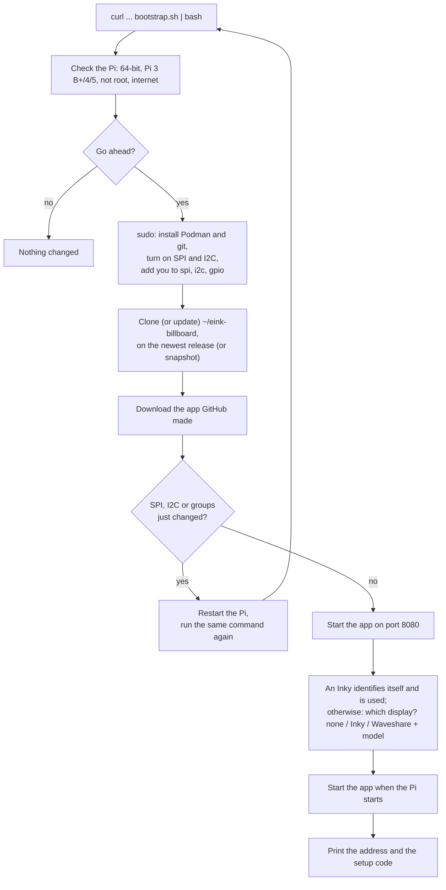

# eInk Billboard

A self-hosted e-ink billboard for a Raspberry Pi. Playlists of data sources (comics, news feeds, calendars, the weather, maps, your own pictures, generated images) fill the panel in turn, timer tasks put a message or an overlay over them at set times, and a web app on your own network manages it all. It drives Pimoroni Inky and Waveshare e-Paper panels, or none while you try it.

> This project is maintained by Claude Sonnet and Opus with Human-in-the-Loop

## Known limitations

* **No real panel has been driven through the container setup yet.** The setup runs start to finish on a Raspberry Pi 5 with no panel attached: the app opens the panel's devices and loads every driver.
* **Plain HTTP unless you turn HTTPS on.** The app serves HTTPS itself (`ssl on`, see [On your network](#on-your-network)); with the device's own certificate a browser warns the first time, since nobody vouches for it.
* **Addresses you type are checked, then fetched.** The check that keeps a feed or picture address off the device and its local services can be fooled by a name that resolves differently the second time (DNS rebinding).
* **Boards with less than 1 GB of memory are experimental** (a Pi Zero 2 W, a Pi 3 A+): see [What you need](#what-you-need).

## Documentation

* How to use the app: the **Help** drawer in the web app (the ? button).
* [The Pi's command line](docs/pi-commands.md): every command of `deploy/eink-container.sh`, its settings and the setup's options.
* [Architecture](docs/architecture.md): the display layers and compositor, the tasks, the storage.
* [Development](docs/development.md): running it locally and in containers, the web API, API metering, telemetry, debugging.
* Working on the code: [CONTRIBUTING.md](CONTRIBUTING.md) and [AGENTS.md](AGENTS.md).

# Set up a Raspberry Pi

From a fresh Raspberry Pi to a working billboard in one command. The app runs in a container (Podman), so the Pi itself only gets Podman, git and its panel connections switched on; Python, the browser that draws the pages and the panel drivers are all inside the container.

> **Status:** the whole setup runs start to finish on a Raspberry Pi 5 (Raspberry Pi OS Bookworm, Podman 4.3), including starting again after a restart, with no panel attached: the app opens the panel's devices and loads every driver inside the container. Driving a real panel is untested, and so is a Pi 3 B+ (the setup accepts it).

## What you need

* A **Raspberry Pi 3 B+, 4 or 5** with **Raspberry Pi OS 64-bit** (Bookworm or later), on your network, with internet access.
  * **Memory:** 1 GB or more is comfortable (the app uses about 135 MB and each page drawn with the browser about 75 to 110 MB). A Pi 3 B+ has 1 GB, as the smallest Pi 4 does. A Pi 3 B, a Pi 3 A+ or a **Pi Zero 2 W** (the smallest 64-bit board) should work too, but only the Pi 5 is tested: with 512 MB it needs swap (`deploy/eink-container.sh check` says), draws one page at a time, and building the image on it is the part most likely to run out of memory. Boards with a 32-bit system only (Pi 1, Pi Zero and Zero W, Pi 2 before the v1.2) cannot run it.
* Your own user on it, allowed to use `sudo` (the user Raspberry Pi Imager makes is).
* A panel, or none yet: a **Pimoroni Inky** (it identifies itself) or a **Waveshare e-Paper** (you choose its model, e.g. `epd7in3e`; the name is on the panel's Waveshare wiki page). With no panel you can still try the whole app; the pages are drawn but not shown.
* Free space for the app's image. (When there is no download for the version you install, it is built on the Pi, which takes much longer and needs about 6 GB free.)

## 1. Run the setup

Sign in to the Pi (over SSH, or a terminal on its desktop) as your own user, **not** with `sudo`, and run:

```
curl -fsSL https://raw.githubusercontent.com/escape-llc/eink-billboard/master/deploy/bootstrap.sh | bash
```

It checks the Pi, **lists what it will do and asks once**, then asks for your password where it needs `sudo`. Add `--dry-run` at the end (`... | bash -s -- --dry-run`) to see the list without changing anything.



## 2. Restart, if it asks

Switching on SPI and I2C and joining the `spi`, `i2c` and `gpio` groups take effect only after a restart. When any of them changed, the setup gets the app first, then asks to restart. After the restart, run **the same command again**: it skips what is done and finishes the rest.

## 3. Claim the device

The setup ends with something like:

```
The device is not set up yet. Open the web app and enter the setup code to choose its password:
    Open the web app:  http://192.168.1.20:8080
    Setup code:        2941 1673
```

Open that address from any computer or phone on your network, enter the setup code, and choose the device's password. The code is also on the panel, and `~/eink-billboard/deploy/eink-container.sh code` shows it again. Until the device is claimed **nothing else plays**: the panel holds the setup page, so whoever can see the panel is its owner.

## 4. Make your first playlist

After you sign in, the web app opens the playlist page, since a new device has none. From here on, the web app explains itself: the **Help** button (the question mark at the right end of its toolbar) walks through the first steps, the pages, the data sources and their keys, and what to do when something is wrong.

## Update

```
~/eink-billboard/deploy/eink-container.sh update
```

It goes to the newest version of the Pi's **channel**, downloads the app GitHub made of it and restarts the app, keeping your settings, playlists and password; when there is nothing new it says so and leaves the app running. Nothing is built on the Pi. (Running the setup command again does the same, and also re-checks the Pi.)

| Channel | What it follows | Choose it with |
|---|---|---|
| **stable** (a new Pi's) | the releases (`v0.1.0`), made when the maintainer says a version is ready; the newest snapshot while there is no release | `update --stable` |
| **insider** | the snapshots: every change to `master`, a few minutes after it is made, named after its time (`20261022143005`); only the few newest are kept | `update --insider` (or `--master`) |
| one version | a release or snapshot by its name, and stays there | `update 20261022143005` |

The channel is remembered (`~/.config/eink-billboard/channel`); a Pi with no channel saved follows what its clone follows (`master`: insider). Going back to an older version (insider to stable, say) asks first.

## On your network

The setup starts the app with these settings from the environment, so set them in front of `start` (or the setup command) to change them, e.g. `EINK_ALLOW_HOSTS=billboard.home.arpa ~/eink-billboard/deploy/eink-container.sh start`:

| Setting | What it does |
|---|---|
| `EINK_PUBLIC_URL` | The address people open, shown with the setup code and on the panel's pages. The default is `http://<the Pi's address>:8080`; set it when you reach the Pi by a name of your own (`http://billboard.home.arpa:8080`) |
| `EINK_ALLOW_HOSTS` | Names the app answers to, besides IP addresses and the Pi's own name (`<name>` and `<name>.local`), comma separated. Any other name is refused (421): that stops a web page on another site from reaching the device by DNS rebinding. A name in `EINK_PUBLIC_URL` counts too |
| `EINK_API_TOKEN` | A token for scripts (`Authorization: Bearer ...`); it also counts as setting the device up. Passed to the container by name, never on a command line |

A client that gets the password or token wrong repeatedly has to wait (429), and each failure is in the log.

**HTTPS.** The app speaks plain HTTP until you turn HTTPS on (over plain HTTP the password reaches the Pi in the clear). The app serves HTTPS itself, on the same port; no proxy is needed:

```
~/eink-billboard/deploy/eink-container.sh ssl on                     # the device's own certificate
~/eink-billboard/deploy/eink-container.sh ssl on cert.pem key.pem    # a certificate of your own
```

* **The device's own certificate** is self-signed and names the Pi's address, its name and `<name>.local` (and `EINK_ALLOW_HOSTS`); it is made again when one of those changes and before it runs out. A browser warns the first time: compare the SHA-256 fingerprint in the log (`deploy/eink-container.sh logs`, the line "Serving HTTPS with ...") with the one the browser shows, then accept it.
* **A certificate of your own** (from your own certificate authority, or `mkcert`) has no warning on the computers that trust it. The two files are PEM (the certificate with its chain, and its key without a passphrase); they are kept as Podman secrets that only the app's user in the container can read, so you may delete the files afterwards.
* **Then** set `EINK_PUBLIC_URL` to the `https://` address if you set one before. `ssl off` goes back to plain HTTP (a certificate you gave is kept for the next `ssl on`), `ssl forget` removes it, and `ssl` alone says which is in use.

Over HTTPS the session cookie is marked `Secure`.

## When something does not work

Run `~/eink-billboard/deploy/eink-container.sh check` first. It looks at the Pi, its devices, the container and the display, and gives a fix for each problem it finds (the lines marked `FIX`). Every command is in [the Pi's command line](docs/pi-commands.md).

## Remove it

```
~/eink-billboard/deploy/eink-container.sh autostart off
~/eink-billboard/deploy/eink-container.sh wipe          # deletes the app's data (asks first)
podman rmi localhost/eink-device
rm -rf ~/eink-billboard ~/.config/eink-billboard ~/.cache/eink-billboard
```

Podman, SPI, I2C and your groups stay as they are.

# License

Apache License 2.0: see [LICENSE](LICENSE). Copyright eScape LLC; the parts by others and their terms are listed in [NOTICE](NOTICE).
